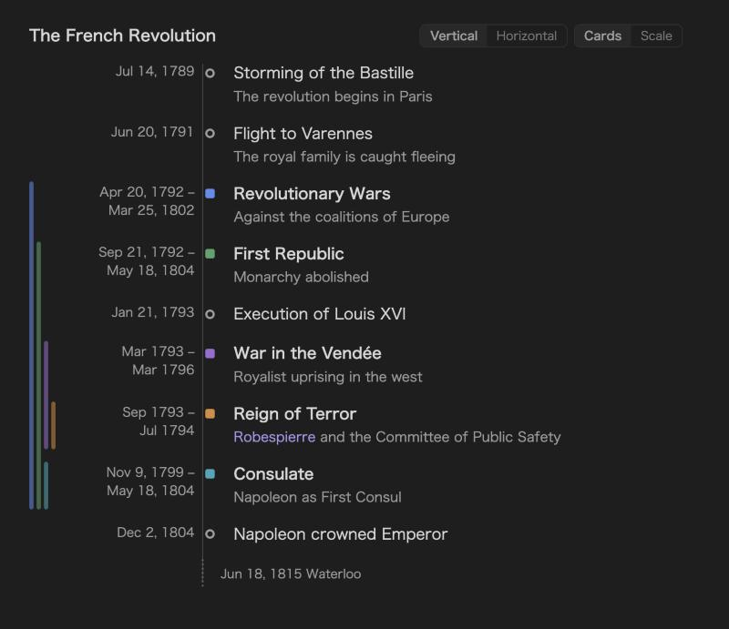
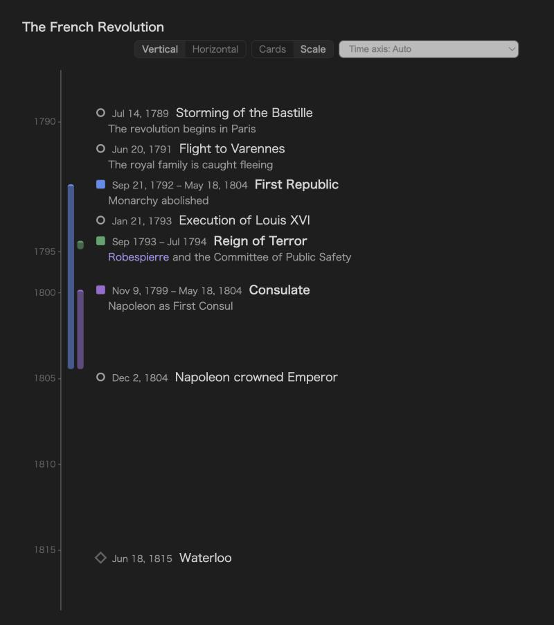
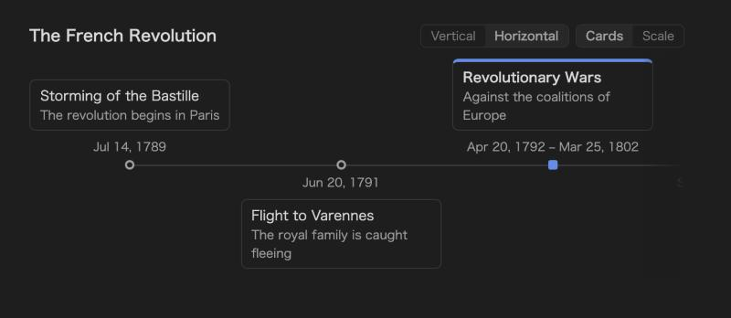
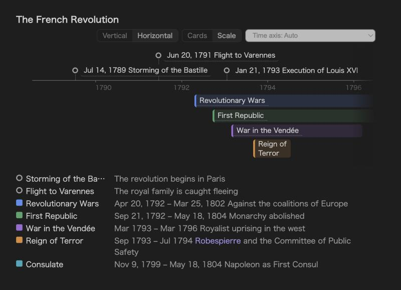
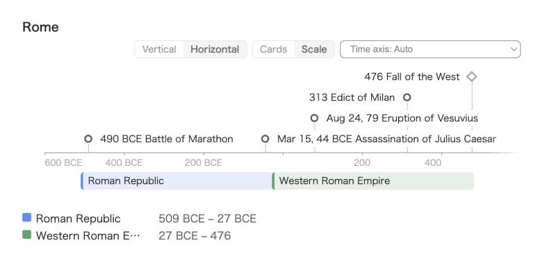
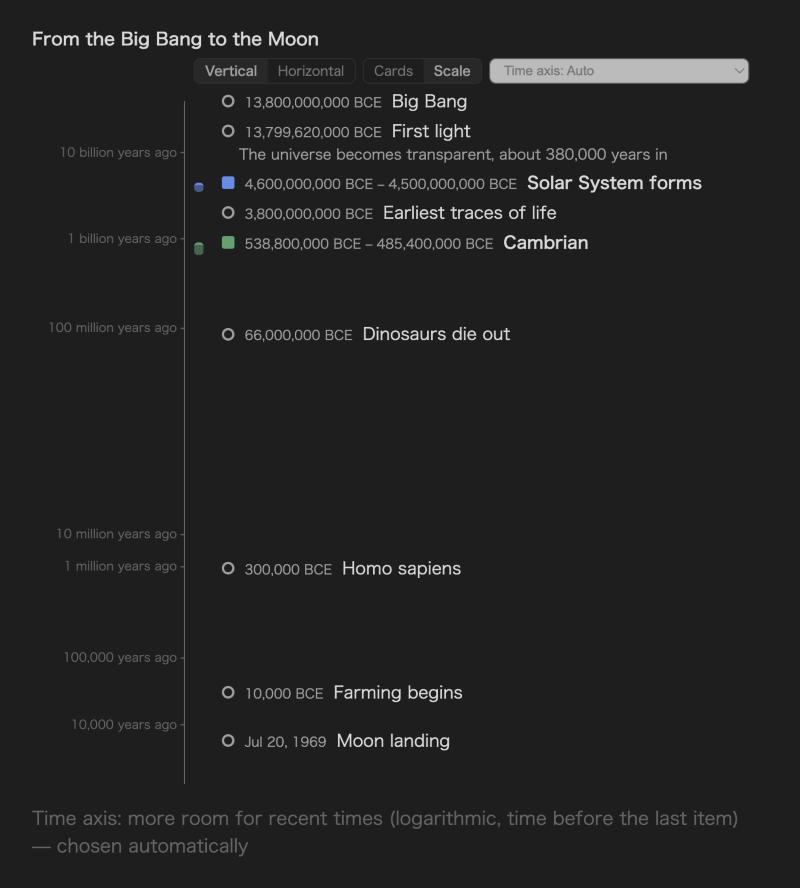
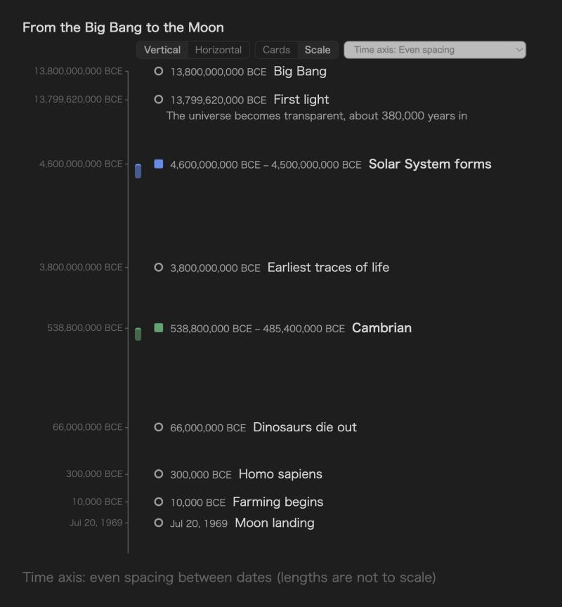
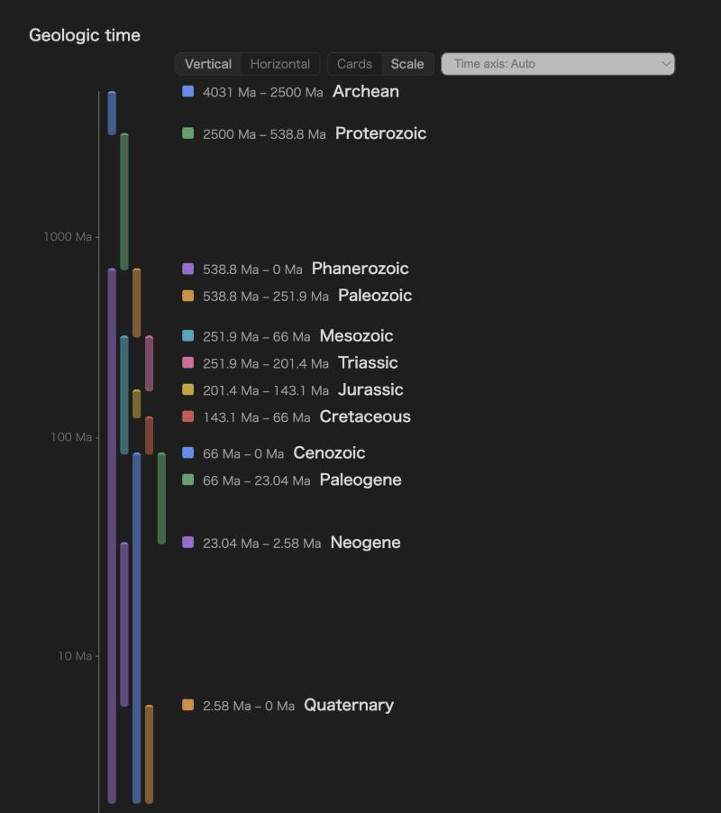
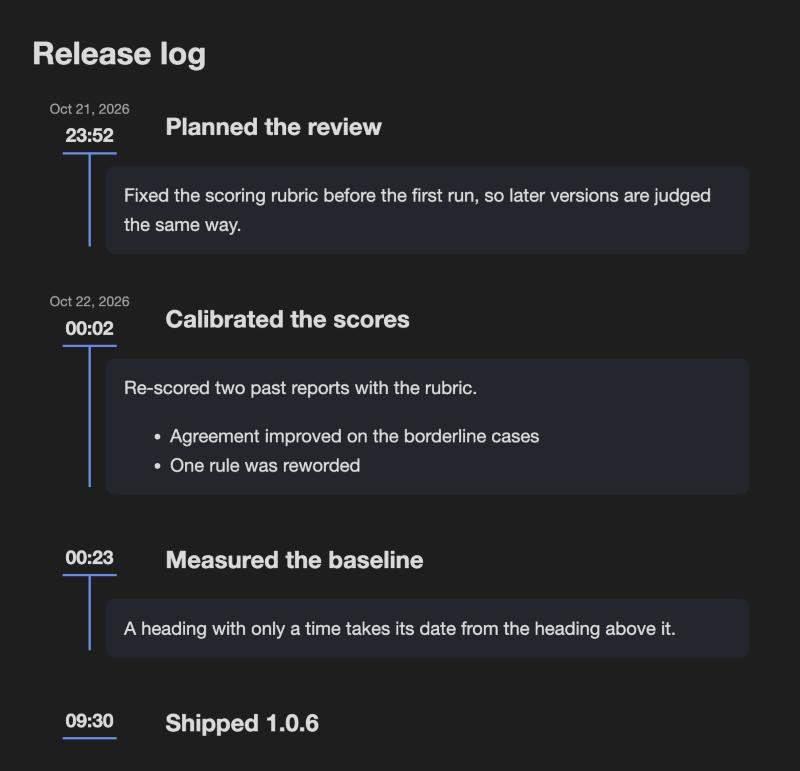
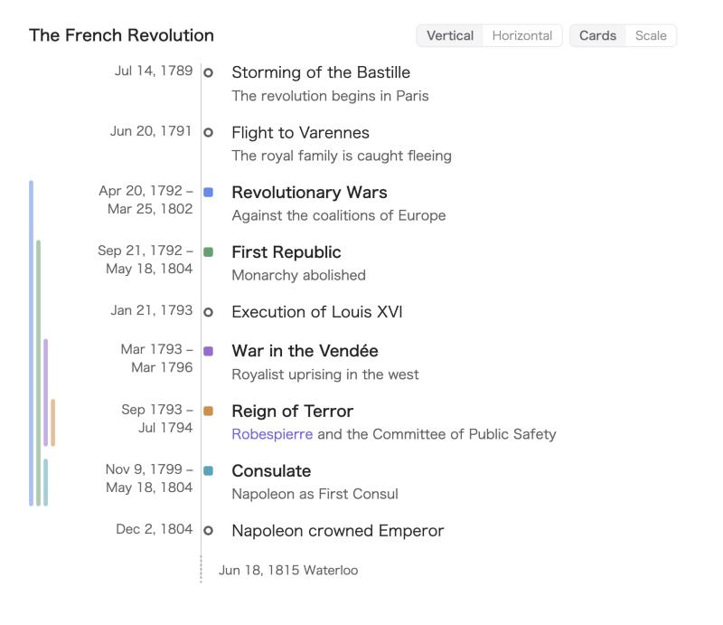

# Plain Timeline

[日本語](README.ja.md)

Write a timeline as plain text in your note and see it drawn — vertically or horizontally, as evenly spaced cards or to scale. Years, months and days, years before the common era, periods that are still going on, and spans as long as the history of the universe all work. Notes written as a log of timed headings can be shown as a timeline too.



## Quick start

Put lines like these in a `plain-timeline` code block:

````markdown
```plain-timeline
> title The French Revolution
- [1789-07-14] Storming of the Bastille | The revolution begins in Paris
@ [1792-09-21~1804-05-18] First Republic | Monarchy abolished
@ [1793-09~1794-07] Reign of Terror | [[Robespierre]] and the Committee of Public Safety
- [1804-12-02] Napoleon crowned Emperor
= [1815-06-18] Waterloo
```
````

`-` is an event, `@` a period, `=` a marker. Text after `|` is the description. Lines starting with `>` are options for this timeline.

## Four layouts

Each timeline has an orientation (vertical or horizontal) and a look (cards or scale). Switch them with the buttons at the top right of the timeline — the choice is written into the block — or write it yourself with `> orientation` and `> look`.

| | Cards — evenly spaced, best for events | Scale — lengths follow time, best for periods |
| --- | --- | --- |
| **Vertical** |  |  |
| **Horizontal** |  |  |

On the horizontal scale, a period's bar shows only its name. A name longer than the bar wraps inside it and the bar grows taller (on a very short bar the name runs along the bar, turned 90°), so text never makes a period look longer than it is. Back-to-back periods share one row, and periods that start together stack from long to short. Dates and descriptions are in the hover note and in the list under the axis.

## Writing items

| Line | Meaning |
| --- | --- |
| `- [date] Name \| description` | An event. A range like `[1914~1918]` is allowed. |
| `@ [start~end] Name \| description` | A period. Leave the end empty (`[2020~]`) for one that is still going on. |
| `= [date] Name` | A marker (a single date). |
| `#red` right after the date | The item's color: blue, green, purple, orange, cyan, pink, yellow, red, gray. Any other `#word` stays part of the name. |
| `- [2026-09-01, 2026-09-10] Name` | Several dates in one line make one item each, sharing the name and description. |
| Indented lines below an item | Continue its description. Full Markdown works there: paragraphs (leave a blank line), lists, links. |
| `# text` | A comment, not shown. |

````markdown
```plain-timeline
- [2026-09-01, 2026-09-10~2026-09-12] Midterm exams | Chapters 1–3
  Bring the textbook and the handouts.

  - Practice set A
  - Practice set B
```
````

### Dates

A date is a year (`1789`), a month (`1789-07`) or a day (`1789-07-14`). Negative years are before the common era (`-490` → 490 BCE); spans of billions of years (`-13800000000`) work too. Write years 1–99 with four digits (`0079-08-24`): a two-digit year next to a month follows the two-digit-year setting (`19-03-04` → 2019).

In the settings you can read dates as day–month–year or month–day–year instead. `-`, `/`, `.` or no separator are all accepted (`20261021`, `21/10/2026` …), and so are full-width digits and `～`.

Lines that cannot be read — a bad date, an unknown option — are listed in a small note under the timeline instead of disappearing.



## Options

An option is a line starting with `>`, followed by its name and a value: `> orientation horizontal`. Put each option on its own line, anywhere in the block (the top is easiest to read). An option changes only this timeline; anything you leave out follows the plugin settings. Every option also has a Japanese name, so `> 向き 横` works the same as `> orientation horizontal`.

### Layout

| Write | What it does |
| --- | --- |
| `> orientation horizontal` | Lay the timeline out horizontally (`vertical` is the default). |
| `> look scale` | Draw it to scale; `cards` spaces items evenly. |
| `> title The French Revolution` | Show a title above the timeline. |
| `> height 300` | Limit the height to 300 px; the timeline scrolls inside. |
| `> density compact` | Tighter spacing (`comfortable` is the default). |
| `> desc hover` | Show descriptions only when you hover an item (`show` always shows them). |

### Range

| Write | What it does |
| --- | --- |
| `> start 1700` / `> end 1900` | Fix where the axis begins or ends. Items outside it are folded to the edge and listed in the note under the timeline. |
| `> today` | Add a marker for today. |

### Time axis

On the scale look, `> axis` decides how time is spread along the axis. You usually don't need it: **auto** (the default) keeps the axis proportional when the dates are spread out, and switches when a proportional axis would squeeze most of them into one spot. Whenever the axis is not proportional, a line under the timeline says so. The picker next to the layout switch changes it, and **Settings → Time axis** sets the default for every timeline.

| Write | The axis | Good for |
| --- | --- | --- |
| `> axis auto` | Chosen from the dates (proportional, recent or even). | Most timelines. |
| `> axis proportional` | Lengths follow time exactly. | History, projects, trips. |
| `> axis recent` | Logarithmic in time before the last item: recent times get more room. | The age of the universe and the last ten thousand years on one line. |
| `> axis early` | Logarithmic in time since the first item: the start gets more room. Never chosen automatically. | The first minutes after the Big Bang. |
| `> axis even` | Each gap between dates gets similar room; lengths are not to scale. | Spans where nothing else is readable. |

| `> axis recent` (chosen by auto) | `> axis even` |
| --- | --- |
|  |  |

````markdown
```plain-timeline
> title From the Big Bang to the Moon
- [-13800000000] Big Bang
- [-13799620000] First light | The universe becomes transparent, about 380,000 years in
@ [-4600000000~-4500000000] Solar System forms
- [-66000000] Dinosaurs die out
- [-300000] Homo sapiens
- [1969-07-20] Moon landing
```
````

To look closer at one part of a proportional axis, widen just that span. Write one line per span:

| Write | What it does |
| --- | --- |
| `> zoom 1939~1945 5x` | Draw 1939–1945 five times wider than the rest. |

### Units for deep time

| Write | What it does |
| --- | --- |
| `> unit Ma` | Dates are millions of years ago, written and shown as such: `@ [538.8~251.9] Paleozoic` is shown as "538.8 Ma – 251.9 Ma". `Ga` (billions) and `ka` (thousands) work too. |



````markdown
```plain-timeline
> title Geologic time
> unit Ma
@ [2500~538.8] Proterozoic
@ [538.8~0] Phanerozoic
@ [538.8~251.9] Paleozoic
@ [251.9~66] Mesozoic
@ [66~0] Cenozoic
@ [2.58~0] Quaternary
```
````

### All options at a glance

| English | Japanese | Values |
| --- | --- | --- |
| `orientation` | `向き` | `vertical` `horizontal` / `縦` `横` |
| `look` | `見た目` | `cards` `scale` / `カード` `時間軸` |
| `title` | `タイトル` | any text |
| `start`, `end` | `開始`, `終了` | a date |
| `today` | `今日` | — |
| `density` | `間隔` | `comfortable` `compact` / `ゆったり` `詰める` |
| `desc` | `説明` | `show` `hover` / `表示` `ホバー` |
| `height` | `高さ` | pixels |
| `axis` | `縮尺` | `auto` `proportional` `recent` `early` `even` / `自動` `比例` `最近を広く` `始まりを広く` `均等` |
| `zoom` | `広げる` | `start~end 5x` / `開始~終了 5倍` |
| `unit` | `単位` | `Ga` `Ma` `ka` / `十億年前` `百万年前` `千年前` |

## Descriptions and links

Text after `|` is the description, and indented lines below an item add to it. `[[Wiki links]]` and `[text](url)` links work in names and descriptions. Clicking an item opens, in order: the link inside it, a note with the same name, or the place in the current note where the name first appears. If an item contains links, only those links are clickable (this can be changed in the settings). ⌘/Ctrl-click opens a new tab; Tab and Enter work too, and links show Obsidian's page preview.

## Note view

A log written as headings can be read as a timeline. Add folders under **Settings → Note view** — one per line, such as `Projects/*/Worklog` (`*` is one folder name, `**` any depth). In reading view, notes inside them show every heading that starts with a date or a time as an entry: the time in a column on the left, the title beside it, and the section below as a card on a line. The note itself stays plain Markdown.



```markdown
## 2026-10-21 23:52 Planned the review
Fixed the scoring rubric before the first run.

## 2026-10-22 00:02 Calibrated the scores
Re-scored two past reports with the rubric.

## 00:23 Measured the baseline
A heading with only a time takes its date from the heading above it.
```

- A heading may start with a date and time (`2026-10-21 23:52`, `2026/10/21 9:30`, `2026-10-22T00:23+09:00`), a date only (`2026-10-21`), or a time only (`09:30`). A date or time in parentheses at the end also works: `## Review (2026-10-22 00:23)`.
- A time-only heading takes its date from the heading above it, else from the note's `date` property or a `YYYY-MM-DD` file name — so a daily note becomes a dated timeline as it is.
- Times are shown as written; time zones are not converted. Headings without a date or time stay as ordinary headings.
- Click a time (or press Enter on it) to edit the note at that entry.

Per folder and per note:

| Where | Write | What it does |
| --- | --- | --- |
| Settings → Note view | `Projects/*/Worklog #green` | A color after the folder tints its notes (otherwise the first period color). |
| Note properties | `plain-timeline: notes` / `plain-timeline: off` | Show this note as a timeline, or not, whatever its folder. |
| Note properties | `plain-timeline-heading: 3` | Use `###` headings as entries in this note (the default level is set in the settings). |

## Settings

The settings set defaults for every timeline; options in a block override them for that block.

Language (English / 日本語 / follow Obsidian) · default orientation and look · time axis (auto, proportional, recent, early, even) · date order in blocks · two-digit years · date display (localized, ISO, or a pattern such as `DD/MM/YYYY`) · BCE label · descriptions always or on hover · clickable items · layout switch · period colors and their order · density · sort order · minimum width of the horizontal axis · notes about unreadable lines · note view folders and heading level.



## Phones and tablets

On phones the vertical layouts become a single column. On phones and tablets the buttons and items are larger, and tapping an item on the horizontal axis shows its details under the timeline. Wide timelines fade at the edge while there is more to scroll.

## Credits

The line syntax is compatible with [Chronos Timeline](https://github.com/clairefro/obsidian-plugin-chronos) (MIT), so existing Chronos-style lines can be pasted into a `plain-timeline` block.

## License

MIT
