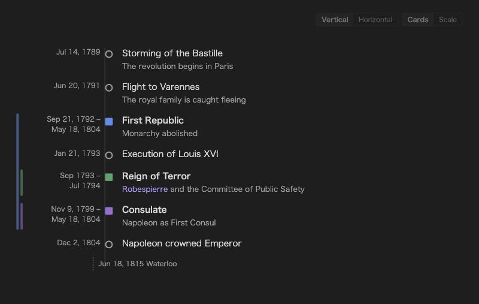
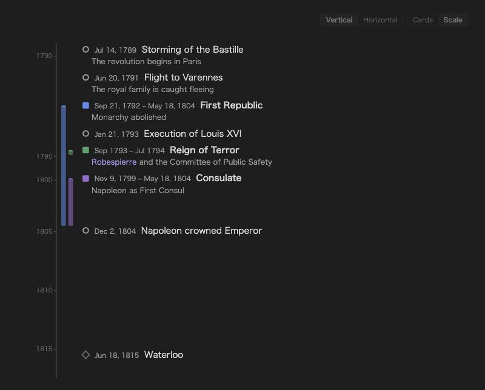
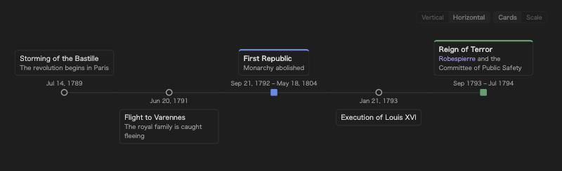
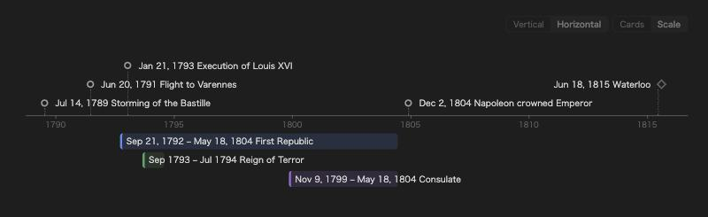
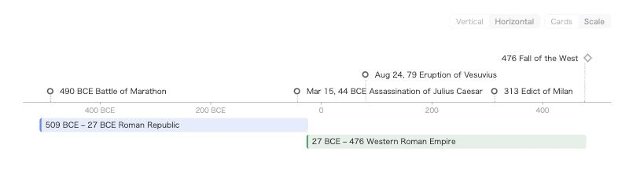
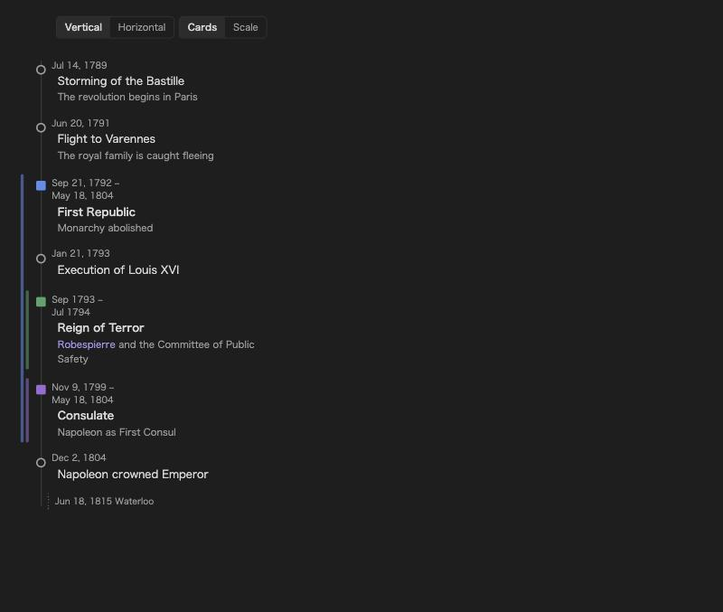
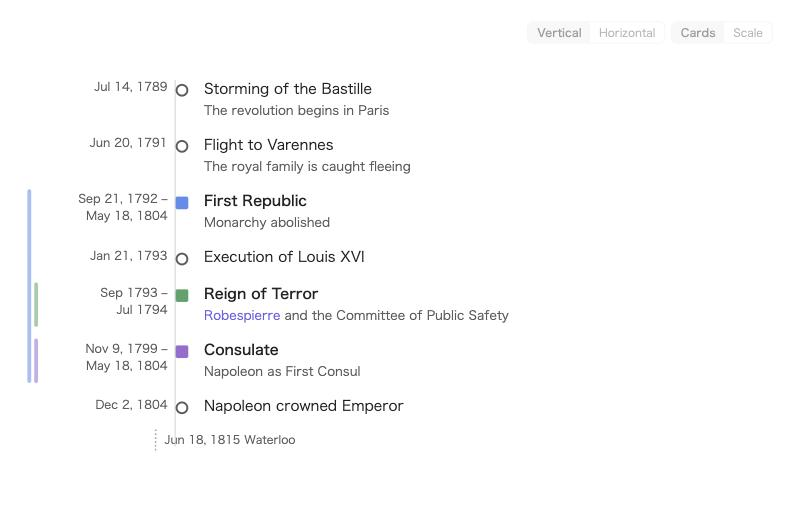

# Plain Timeline

[日本語](README.ja.md)

Write a timeline as plain text in your note and see it drawn — vertically or horizontally, as evenly spaced cards or to scale. Year-only dates, months, days, years before the common era and periods that are still going on all work.



## Four layouts

Each timeline picks its own orientation and look. Use the small switch at the top right of a timeline, or write it in the block.

| | Cards — evenly spaced, best for events | Scale — lengths follow time, best for periods |
| --- | --- | --- |
| **Vertical** |  |  |
| **Horizontal** |  |  |

## Syntax

````markdown
```plain-timeline
> title The French Revolution
- [1789-07-14] Storming of the Bastille | The revolution begins in Paris
@ [1792-09-21~1804-05-18] First Republic | Monarchy abolished
@ [1793-09~1794-07] #red Reign of Terror | [[Robespierre]] and the Committee of Public Safety
- [-490] Battle of Marathon
= [1815-06-18] Waterloo
```
````

### Lines

| Line | Meaning |
| --- | --- |
| `- [date] Name \| description` | An event. A range like `[1914~1918]` is allowed. |
| `@ [start~end] Name \| description` | A period. Leave the end empty (`[2020~]`) for one that is still going on. |
| `= [date] Name` | A marker (a single date). |
| `#red` right after the date | Color for that item: blue, green, purple, orange, cyan, pink, yellow, red, gray. Any other `#word` stays part of the name. |
| `# text` | Comment, not shown. |
| `- [2026-09-01, 2026-09-10] Name` | Several dates in one line make one item each, sharing the name and description (`,` `、` also work). |
| Indented lines below an item | Continue its description. Full Markdown works there — several paragraphs (leave a blank line), lists, links. |

A longer item looks like this:

````markdown
```plain-timeline
- [2026-09-01, 2026-09-10~2026-09-12] Midterm exams | Chapters 1–3
  Bring the textbook and the handouts.

  - Practice set A
  - Practice set B
```
````

### Options

| Option | Meaning |
| --- | --- |
| `> orientation horizontal` | This timeline is horizontal (`vertical` is the default). |
| `> look scale` | Drawn to scale (`cards` otherwise). |
| `> title Text` | A title above the timeline. |
| `> start 1700` / `> end 1900` | Fix the range of the time axis. Items outside it are folded to the edge and listed in a note. |
| `> today` | Add a marker for today. |
| `> density compact` | Tighter spacing for this timeline. |
| `> desc hover` | Show descriptions only on hover for this timeline (`show` to always show them). |
| `> height 300` | Limit the height; the timeline scrolls inside it. |

Every option can also be written in Japanese (`> 向き 横`, `> 見た目 時間軸`, `> タイトル …`, `> 開始`, `> 終了`, `> 今日`, `> 間隔 詰める`, `> 説明 ホバー`, `> 高さ`).

### Dates

Dates can be a year (`1789`), a month (`1789-07`) or a day (`1789-07-14`). Negative years are before the common era (`-490` → 490 BCE); very large spans such as `-13800000000` work too. Write years 1–99 with four digits (`0079-08-24`), because a two-digit year next to a month follows the two-digit-year setting (`19-03-04` → 2019).

In the settings you can switch the order to day–month–year or month–day–year. Separators `-`, `/`, `.` or none are all accepted (`20261021`, `202610`, `21/10/2026`, `211026` …), and so are full-width digits and `～` typed with a Japanese input method.

Lines that cannot be read — a bad date, an unknown option or value, an item outside `> start`/`> end` — are listed in a small note under the timeline instead of disappearing silently.



## Descriptions and links

Text after `|` is the description. Both `[[wiki links]]` and `[text](url)` links work inside names and descriptions. On the horizontal time axis, descriptions appear beside an item when you hover it, and are also listed under the axis when set to "always show".

Clicking an item opens, in order: the link inside it, a note with the same name, or the place in the current note where the name first appears. If an item contains links, only those links are clickable (this can be changed in the settings). ⌘/Ctrl-click opens a new tab. Items can be reached with Tab and opened with Enter, and links show Obsidian's page preview.

## The time axis

The scale look picks calendar steps — days, weeks, months or years — to fit the width, keeps half a step of air at each end, and labels the year where it changes. Labels never overlap: when items are close together, the axis stretches a little there.

## Mobile

On phones the vertical layouts become a single column. On phones and tablets the buttons and items are larger, and tapping an item on the horizontal axis shows its details under the timeline. Wide timelines fade at the edge while there is more to scroll.



## Settings

Language (English / 日本語 / follow Obsidian) · default orientation and look · date order in blocks · two-digit years · date display (localized, ISO, or a custom pattern such as `DD/MM/YYYY` or `YYYY年M月D日`) · BCE label · descriptions always or on hover · clickable items · layout switch · period colors and their order · density · sort order · minimum width of the horizontal axis · notes about unreadable lines.



## Credits

The line syntax is compatible with [Chronos Timeline](https://github.com/clairefro/obsidian-plugin-chronos) (MIT), so existing Chronos-style lines can be pasted into a `plain-timeline` block.

## License

MIT
